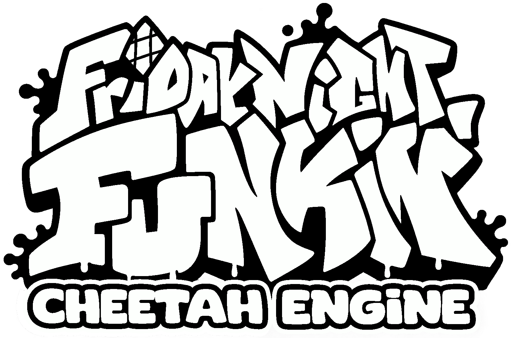

#### Customization

If you wish to disable things like *Lua Scripts* or *Video Cutscenes*, refer to the `Project.xml` file.

Inside `Project.xml` you will find several variables to customize the engine to your liking.

To start you off, disabling *Video Cutscenes* is simple: delete the `"VIDEOS_ALLOWED"` line or comment it out by wrapping it in XML-like comments, like this: `<!-- YOUR_LINE_HERE -->`.

The same goes for *Lua Scripts*: comment out or delete the line with `LUA_ALLOWED`. These and other customization options are all available in `Project.xml`.

## Modding and scripting

For scripting with `.lua` and `.hx`, head over to [the wiki](https://shadowmario.github.io/psychengine.lua).

There you can learn how to use the 212 PlayState functions in your mod.

## What Cheetah Engine adds

### Cheetah Engine Options

Found in **Options → Cheetah Engine Options**:

- **Reset Custom Main Menu** deletes the saved `mainmenu.json` and `menu_custom.json` for the current mod and the global mods folder, restoring the stock menu. It asks for confirmation first and is safe to repeat when no custom menu exists.
- **Windows API Events** is a master switch for every chart event that calls the Windows API, including the cosmetic ones that are otherwise always allowed. Exit cleanup still runs so the desktop is never left altered. On by default; non-Windows builds show it as unavailable.
- **Erect Mix Unification** merges erect remixes into their base song as Erect/Nightmare difficulties in Freeplay (on by default). Off shows them as ordinary standalone songs instead of hiding them.

### Mixes Editor

Press **7** on the main menu and choose **Mixes Editor** to mark songs as `normal` or `erect` and pair them. Select a song, press `1` or `2` to set its type, then `ENTER` and pick its partner. `0` clears a song, `DEL` removes a pair, `S` saves, `BACK` saves and exits. Pairs are stored per mod in `mods/<mod>/data/mixes.json` and take priority over the `-erect` name convention in Freeplay when Erect Mix Unification is enabled. `pico` is also a valid explicit mark; Weekend 1 songs default to it because Pico sings them in the base game.

### Pico vocals in Freeplay

Press **TAB** in Freeplay to open the **character selector**, a separate screen where **LEFT/RIGHT** or **TAB** pick BF or Pico, **ENTER** confirms and **ESC** cancels. A small indicator at the top-left of Freeplay shows the chosen character and the vocals actually in use.

Selector art is optional and lives under `assets/shared/images/CharSelect/`: `bg/` (base, stage, animated `crowd/`, curtains), `titles/` (`boyfriend.png`, `Pico.png`, `placeholder.png`) and `char/<Name>/` (FlxAnimate `Animation.json` + `spritemap1.*` with `<id> cs idle/confirm/deselect` symbols). Missing files fall back to the plain text UI, so art can be added gradually. When a `(Pico Mix)` chart is installed for the selected song and difficulty, the toggle loads that chart for both the preview and gameplay and gives it its own score bucket; otherwise the base chart is used. Weekend 1 songs (Darnell, Lit Up, 2Hot, Blazin) are marked as Pico songs by default, so an installed mix is optional for them. The choice is saved as `picoVocalMode` in `ClientPrefs`.

### Cursor

The stock Psych Engine pointer is replaced by a state-driven cursor from `assets/shared/images/cursor`. The cursor stays visible in every state, including gameplay.

- Menus, options, gameplay and a held mouse button: `cursor-default`
- Chart editor, note under the pointer: `cursor-pointer`
- Chart editor, moving a note: `cursor-grabbing`
- Locked item under the pointer: `cursor-cross`
- Scrollable region: `cursor-scroll`
- Text field: `cursor-text` (or `cursor-text-vertical` for tall fields)
- Editor zoom in/out: `cursor-zoom-in` / `cursor-zoom-out`
- Loading: `cursor-hourglass`
- Other editors: `cursor-pointer`

### Accessibility

Found in **Options → Accessibility**:

- **Colorblind-safe palettes** for lane colors, applied to arrows, strums and note splashes. `Off` keeps the original behavior and your custom Note Colors.
- **Reduced camera shake** damps every gameplay shake, including event, Lua and stage-scripted ones. Stage scripts cannot bypass it.
- **Text size** scales the sprite-font text used by menus and dialogue. Default is `1.0`.
- **Offset calibration** lives in **Options → Note/Beat Delay** and uses the main-menu backdrop: a centered receptor with gameplay-style arrows rising toward it. Press **Accept** to switch between **Combo Offset**, **Audio Offset** and **Video Offset**. In either offset tab, press **C** (keyboard) or **Y** (gamepad) to run both passes: tap 8 times to the drum beat (audio latency → `noteOffset`), then 8 times when an arrow reaches the receptor (display latency → `videoOffset`). Both values are applied and saved; the video offset shifts only how notes are drawn, never their hit timing. Manual left/right adjustment, hold-to-scan, reset and combo dragging still work as before.

### File Access sandbox

Found in **Options → File Access**. Lua/HScript mods otherwise have full filesystem access, so this sandbox limits what a downloaded mod can touch:

- **Safe Mode** (on by default) confines script writes and deletes to the mods folder. Reads may also reach the executable's folder. Paths containing `..` are always refused.
- With Safe Mode off, five switches decide access by file type: data (`txt`, `json`, `xml`, `csv`, `lang`, `ini`, `md`, `frag`, `vert`), scripts (`lua`, `hx`, `hscript`, `hxs`), images (`png`, `jpg`, `jpeg`, `webp`, `gif`), audio (`ogg`, `mp3`, `wav`, `flac`) and other. All default to `true`, so turning Safe Mode off restores the original behavior exactly.
- While Safe Mode is on, scripts cannot resolve filesystem, network, process or Lime system classes by name (`sys.io`, `sys.FileSystem`, `sys.net`, `sys.ssl`, `lime.system`, `sys.Process`, `sys.net.Socket`).
- Every denial is logged with the script name, operation, path and the rule that blocked it.

> **Note:** HScript is arbitrary Haxe compiled at runtime. The HScript gate is a speed bump for ordinary mods, not a security wall; determined code using constructed class names can still get through.

### Mod browser

**Mods → INSTALL MODS** opens an in-game browser for GameBanana's [Psych Mod Folders](https://gamebanana.com/mods/cats/28367) category. It shows 10 mods per page with name, author, category and views, and supports next/previous page.

Selecting a mod downloads the first non-archived `.zip` from its profile page and extracts it into `mods/`. The installer detects the mod folder inside the archive, strips a leading `mods/` prefix, rejects path traversal entries, skips `__MACOSX/`, `.DS_Store` and `Thumbs.db`, and never overwrites an existing folder (it appends a numeric suffix). The mod is then registered as enabled in `modsList.txt`; a game restart is required.

Downloads are capped at 400 MB because the archive is held in memory. Before the first install of a session, an in-state warning reminds you that mods are third-party code that can run Lua/HScript and to install only trusted mods.

The installer finds the real mod folder inside nested wrapper archives, so the installed folder contains the mod instead of the wrapper. Archives with no Psych mod content are rejected. When a GameBanana entry points to an external host such as Google Drive instead of a `.zip` download, the browser tells you to download and install the mod manually into `mods/`. If the mod's `pack.json` declares a Psych Engine version, the result screen reports compatibility with this engine's Psych 1.0.4 base; a mismatch is a warning and the mod still installs.

### Editors

- The Menu Customization Hub is trimmed down to the Main Menu editor.
- **Achievement Editor** is available from debug key 7. It lets you create, modify and remove custom achievements, with a unique save key, display name, description, hidden flag, max score and max decimals. Built-in achievements cannot be overwritten.
- Custom achievements can have their own icon under `images/`, with a live preview in the editor.
- A new **Unlock Achievement** chart editor event unlocks an achievement by save key when playback reaches it.
- All other existing editors keep working as before.

### Base game content

The original weeks and songs are restored in debug builds, including their weeks, characters, stages, audio and charts.

### Windows API song events

Windows builds can drive the OS window and desktop from chart events. The Chart Editor lists every event with its value formats; the gates live in **Options → Windows API**, with an additional master switch in **Options → Cheetah Engine Options** that refuses every Windows API event at once:

- Always available: window border and title-bar text color, dark mode, corner style, opacity and centering.
- Disabled by default, one switch each: hiding the taskbar or desktop icons, changing the wallpaper, screen captures and GDI effects. A chart cannot use any of them until you enable the matching switch.
- On exit, including the crash path, the engine restores the taskbar, desktop icons, desktop position/alpha and wallpaper, and stops every GDI effect. Screenshots taken during the session are deleted only if you enable that option.
- Non-Windows builds keep compiling; these events are ignored there.

Requires `sl-windows-api` (`haxelib install sl-windows-api`) plus the Windows toolchain from the build instructions.

## Credits

### Cheetah Engine Team 

[Cheetah](https://www.youtube.com/@CheetahTheGamer) - Owner [IamDanteDav](https://www.youtube.com/@IamDanteDev) - Coder [Commander Video](https://gamebanana.com/members/1787065) - [Modchart editor](https://gamebanana.com/scripts/12931) [Slushi](https://github.com/Slushi-Github) - [Windows API](https://github.com/Slushi-Github/SL-Windows-API/) 

### Psych Engine Team 

### The Funkin Crew Inc.
